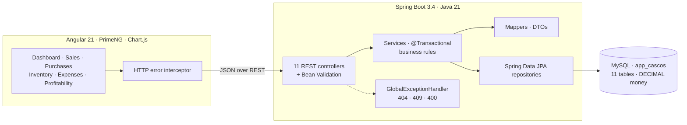
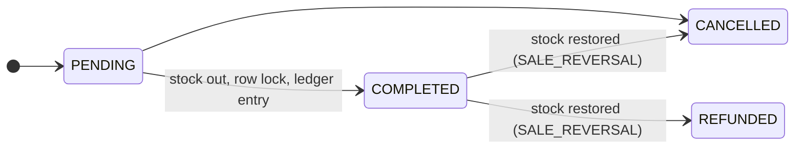
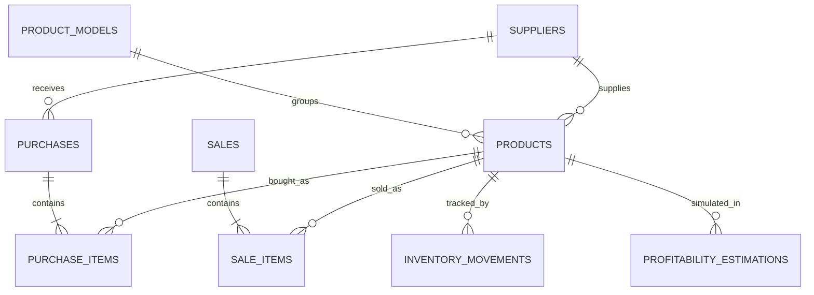

<div align="center">

# 🎧 Resale Admin Console — Inventory, Sales & Profitability

**A full-stack back-office for a headphone resale business: purchases, stock, multi-platform sales, expenses and real profit, with an inventory ledger that stays consistent under concurrent sales.**


</div>

<!-- Add a screenshot of the dashboard here -->

---

## At a glance

| | |
|---|---|
| 🔌 **REST API** | **64 endpoints** across 11 controllers (`/api/products`, `/api/sales`, `/api/dashboard/charts/...`) |
| 🗄️ **Database** | 11 MySQL tables · 13 foreign keys · **34 `CHECK` constraints** · 44 indexes |
| 🧱 **Backend** | ~5,500 lines of Java in a layered architecture (controller → service → repository) |
| 🧪 **Tests** | 26 unit tests (JUnit 5 + Mockito) focused on business-rule violations |
| 📊 **Frontend** | Dashboard with 6 chart endpoints, profitability calculator, 5 CRUD screens from one generic component |

## The problem

Reselling headphones on Wallapop, Vinted or eBay looks profitable until you add **shipping both ways, platform commissions, packaging and the units that never sell**. Spreadsheets lose track of stock and hide the real margin. This console answers the questions that matter:

- *How much stock do I really have, and what is it worth?*
- *What did I actually earn this month, after every cost?*
- *If I buy 10 units at this price, what is my ROI and break-even price?*

## Architecture



## The core business flow



Purchases mirror this flow: stock is **added only when an order is `RECEIVED`** and reverted if it is cancelled afterwards.

## Engineering highlights

### Data integrity
- **No overselling under concurrency.** Before touching stock, products are loaded with `@Lock(PESSIMISTIC_WRITE)` (`SELECT … FOR UPDATE`). Two sales completing at the same moment cannot both take the last unit.
- **Available vs. physical stock.** A sale checks `currentStock − reservedStock`, not raw stock.
- **Append-only inventory ledger.** Every stock change writes an `InventoryMovement` with type (`PURCHASE`, `SALE`, `SALE_REVERSAL`, `MANUAL_IN`, `CORRECTION`…), previous stock, resulting stock and reason: a full audit trail of how each number came to be.
- **Idempotent state transitions.** A `stockApplied` flag prevents applying a sale twice, and blocks editing or deleting a sale whose stock is already applied.
- **Defence in depth.** Validation in the DTOs (Bean Validation), in the services (business rules), and in the database (34 `CHECK` constraints and foreign keys) so invalid prices, quantities or stock can't be stored even by a buggy client.
- **Money as `BigDecimal` / `DECIMAL`**, never floating point, with explicit `RoundingMode.HALF_UP`.
- **`ddl-auto=validate`**: Hibernate checks the entity model against the hand-written SQL schema at startup instead of silently altering tables.

### Finance logic
- **Real profit**: income − product cost − sale costs (commission, shipping, extras) = gross profit; minus general expenses = net profit. Available per period, per product and per model.
- **Profitability simulator** (before you buy): total investment, expected income after an estimated loss rate, percentage and fixed commissions, profit per unit, **margin, ROI, break-even price and break-even units**.

### API and frontend design
- **Consistent error contract**: one `@RestControllerAdvice` maps domain exceptions to `404 / 409 / 400` with a structured `ErrorResponse` (message, path, timestamp).
- **Configuration-driven UI**: products, suppliers, expenses, inventory and sales are all rendered by **one** `GenericResource` component, configured through route data (columns, labels, money fields, form fields, option endpoints). Adding a new CRUD screen is configuration, not code.
- **Environment-based config**: database host, port, name and user come from environment variables with sensible defaults; Jackson and Hibernate are pinned to `Europe/Madrid`.

## Domain model



Plus `expenses` (packaging, shipping, other) and `settings` (key/value configuration).

## Quick start

**Requirements:** Java 21+, Maven 3.9+, Node.js 20+, MySQL 8 (or MariaDB).

```bash
# 1. Database (safe to re-run: no DROP, CREATE ... IF NOT EXISTS)
mysql -u root -p < database/seed.sql

# 2. Backend -> http://localhost:8080/api
cd backend
DB_USERNAME=root mvn spring-boot:run

# 3. Frontend -> http://localhost:4200
cd ../frontend
npm install && npm start
```

Run the tests with `cd backend && mvn test`. Database settings can be overridden with `DB_HOST`, `DB_PORT`, `DB_NAME` and `DB_USERNAME`; see [`database/README.md`](database/README.md) for import, verification and backup steps.

## Project structure

```text
├── backend/                 # Spring Boot 3.4 · Java 21
│   └── src/main/java/com/marcos/cascos/
│       ├── controller/      # 11 REST controllers
│       ├── service/impl/    # Business rules, @Transactional
│       ├── repository/      # Spring Data JPA (+ pessimistic locks)
│       ├── entity/ dto/ mapper/ enums/
│       └── exception/       # Domain exceptions + global handler
├── frontend/                # Angular 21 · PrimeNG · Chart.js
│   └── src/app/
│       ├── features/        # dashboard, profitability, reports, generic-resource
│       ├── core/            # API client, domain services, error interceptor
│       └── layout/          # Admin shell
└── database/
    └── seed.sql             # Schema: tables, FKs, CHECKs, indexes
```

## Tech stack

| Layer | Tools |
|---|---|
| Backend | Java 21, Spring Boot 3.4 (Web, Data JPA, Validation), Hibernate |
| Database | MySQL / MariaDB (InnoDB, utf8mb4) |
| Frontend | Angular 21, TypeScript (strict), PrimeNG, Chart.js, reactive forms |
| Testing | JUnit 5, Mockito |

## Next steps

- Authentication (Spring Security + JWT) for multi-user access
- Database migrations with Flyway instead of a single seed script
- Integration tests with Testcontainers (MySQL) and a CI pipeline
- Docker Compose for one-command startup

---

<div align="center">

Built by **Marcos** · [@mmartinezvaras](https://github.com/mmartinezvaras)

</div>
